<h1 align="center">GetFarman</h1>

<p align="center">
  
</p>

<p align="center">
  <a href="https://www.npmjs.com/package/getfarman"></a>
  <a href="https://www.npmjs.com/package/getfarman"></a>
  <a href="https://packagephobia.com/result?p=getfarman"></a>
  <a href="LICENSE"></a>
</p>

<p align="center">GetFarman is a sidecar prompt coach for Claude Code. It keeps a glossary and teaches you the exact terms to use.</p>

<hr>

GetFarman is a prompt buddy. Its goal is to help you, the operator, write prompts with more specific terms. It does three jobs. It coaches your prompts, it corrects your terminology and it keeps a glossary of the terms that you learnt.

GetFarman is a sidecar, which means that it runs beside Claude Code and never inside your session. It keeps a log of the prompts that you send and of what Claude answered. In the background, Haiku or Sonnet reviews them. For each prompt you get the standard term for the thing that you described and the shortest prompt that would have given the same result. Nothing is written into your chat.

GetFarman can also read the conversations that Claude Code already keeps on your computer, so the log covers work from before you installed it. It only reads them. It still runs beside Claude Code and changes nothing in it.

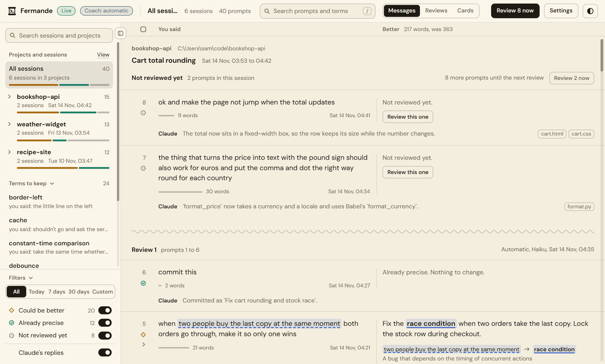

The screenshots on this page show sample data.

## Contents

- [How it works](#how-it-works)
- [The page](#the-page)
  - [Messages](#messages)
  - [Reviews](#reviews)
  - [Glossary](#glossary)
  - [Filters](#filters)
  - [The View choices](#the-view-choices)
  - [The folded sidebar](#the-folded-sidebar)
  - [Pick the prompts to review](#pick-the-prompts-to-review)
  - [Settings](#settings)
  - [Dark theme](#dark-theme)
- [Install](#install)
- [Commands](#commands)
- [Privacy](#privacy)
- [Licence](#licence)
- [Full guide](#full-guide)

## How it works

1. You send a prompt in Claude Code. A hook saves the prompt to a file on your computer.
2. Claude replies. A second hook saves the end of the reply and the names of the files that changed.
3. After every 10 new prompts in a session, Haiku reviews those 10 in the background. You can choose Sonnet instead.
4. You open the page at `http://127.0.0.1:4777/` and read the results.

The hooks run outside the model and print nothing, so they add nothing to what Claude reads. No program stays running between prompts.

The reviewer marks each prompt as "Could be better" or "Already precise". For a prompt that could be better it writes the shorter prompt, the term for each lay phrase and a short definition. It works out what you meant from Claude's reply and from the changed files.

## The page

Run `getfarman open` in a terminal or type `/getfarman` in a Claude Code session. The page opens in your browser. It answers on `127.0.0.1` only, which means that only your own computer can reach it.

The page opens on Messages with every session in the list, as in the screenshot above. The newest prompt is at the top.

The sidebar on the left lists your projects and sessions, the terms to keep and the filters. The top bar holds the search box, the three views, "Review now", Settings and the theme button.

A prompt that waits for a review says "Not reviewed yet". "Review now" sends every waiting prompt in the list to the reviewer.

Each part below has two pictures. The first shows the whole page with a red box round the part. The second shows that part close up.

### Messages

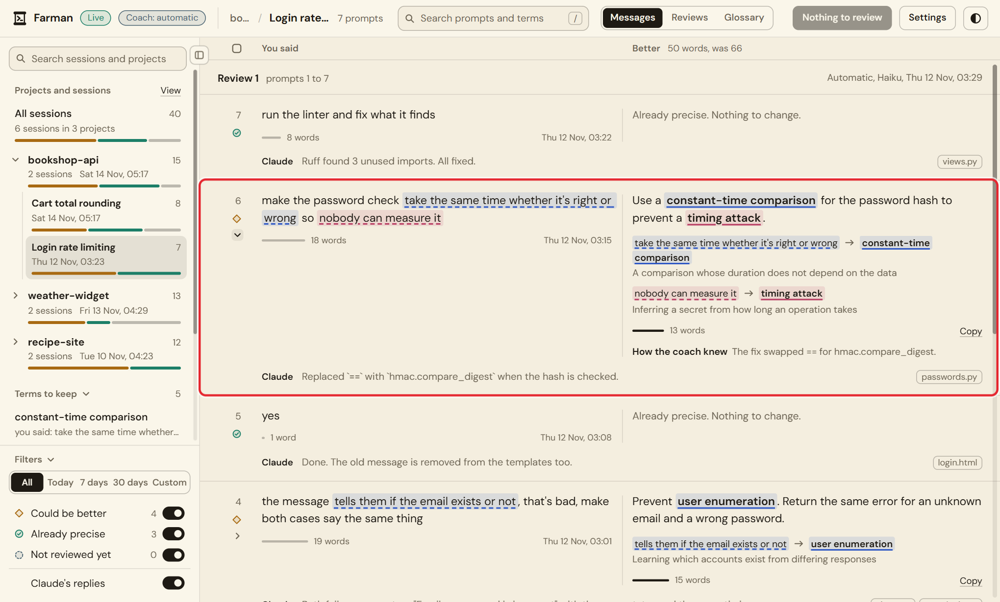

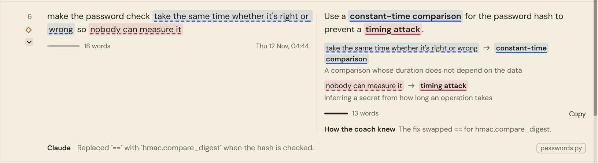

Your prompt is on the left and the better prompt is on the right. A lay phrase has a dashed underline. Its term has a solid underline in the same colour. The definition of the term is under the pair. Claude's reply and the changed files are below.

The arrow under a prompt's number opens the details. "How the coach knew" says what in the reply or in the files showed the reviewer what you meant.

Click a project or a session in the sidebar to see only its prompts. "Terms to keep" then lists the terms of that session.

### Reviews

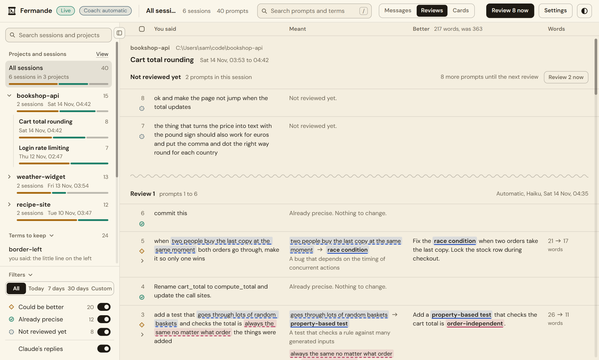

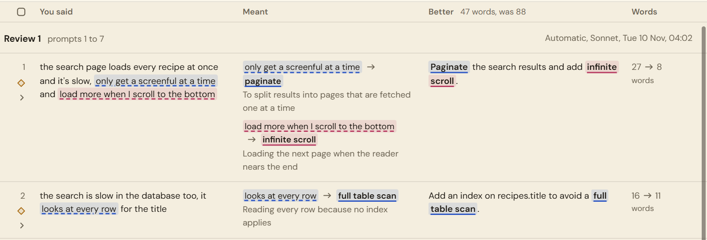

Reviews shows the same prompts as a table. The columns are You said, Meant, Better and Words. Words gives the length of your prompt and the length of the better one.

### Glossary

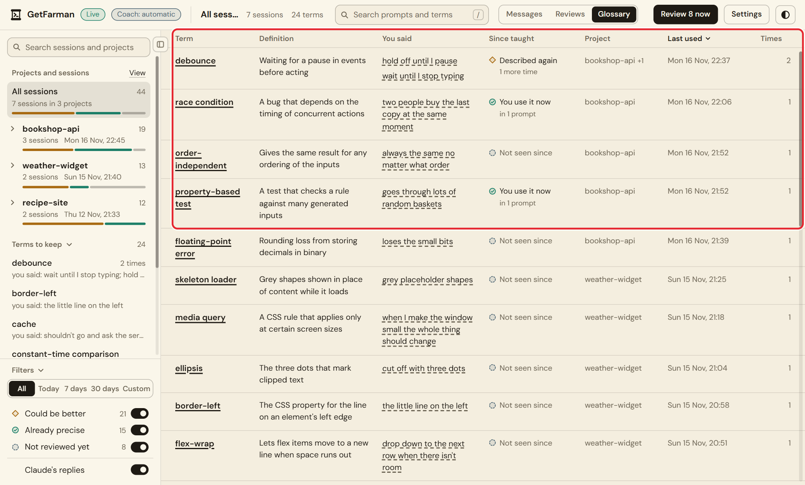

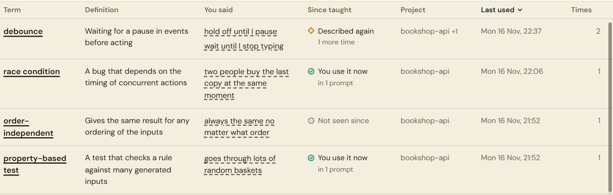

Glossary has one row for each term. A row gives the term, its definition, what you said instead, what happened since it was taught, the project, when it last came up and how often. Click a column name to sort by it. Click a term to see the prompts that it came from.

The Since taught column shows whether a term has stuck. GetFarman compares your later prompts with the term as plain text and uses no model for it.

| Sign | Meaning |
|---|---|
| You use it now | A later prompt of yours holds the term. |
| Described again | After the term was taught, you described the same thing in other words. |
| Not seen since | No later prompt used the term or described it again. |

### Filters

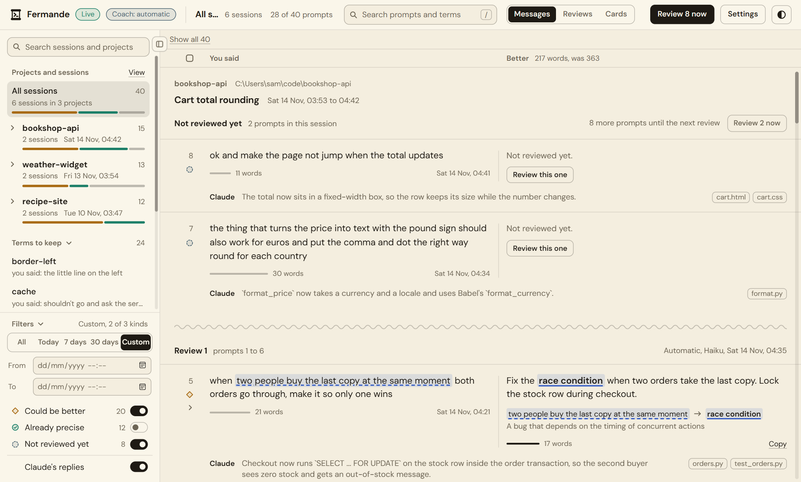

<p align="center">
  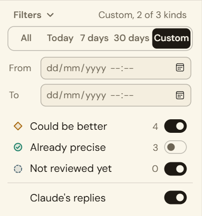
</p>

The filters are at the bottom of the sidebar. Choose a period (All, Today, 7 days or 30 days) or choose Custom and set your own From and To.

Three switches show or hide the prompts that could be better, the ones that are already precise and the ones that are not reviewed yet. A fourth switch hides Claude's replies.

### The View choices

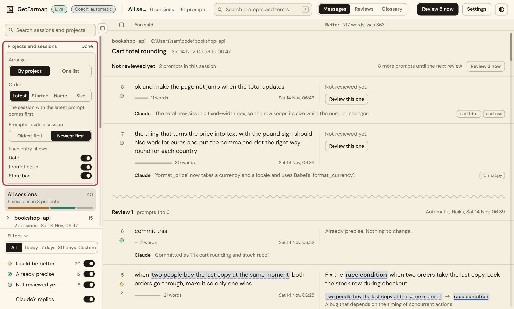

<p align="center">
  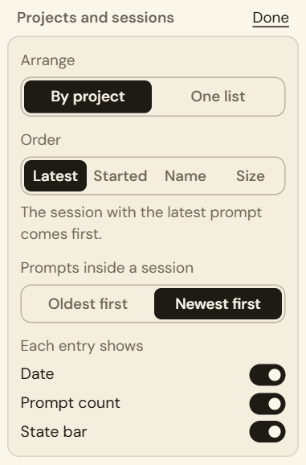
</p>

"View" opens the choices for the sidebar. Arrange the entries by project or as one list. Order them by latest prompt, start, name or size. Show the prompts of a session oldest first or newest first. Choose whether an entry shows its date, its prompt count and its state bar.

### The folded sidebar

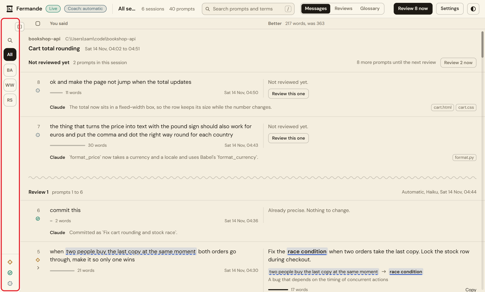

<p align="center">
  
</p>

The button at the top edge of the sidebar folds it to a narrow rail. The rail keeps two letters for each project and the three filter signs. The same button opens the sidebar again.

### Pick the prompts to review

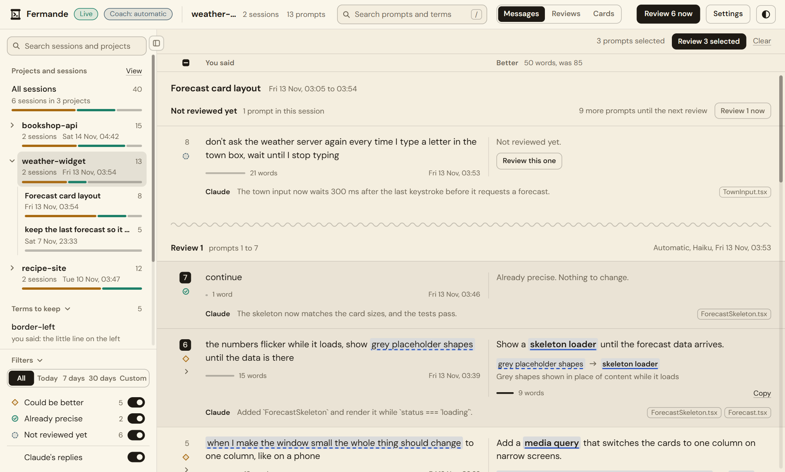

<p align="center">
  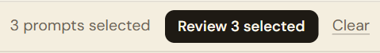
</p>

Click a prompt's number to select it. "Review selected" then reviews only the prompts that you picked. A prompt that was reviewed before is reviewed again in place.

### Settings

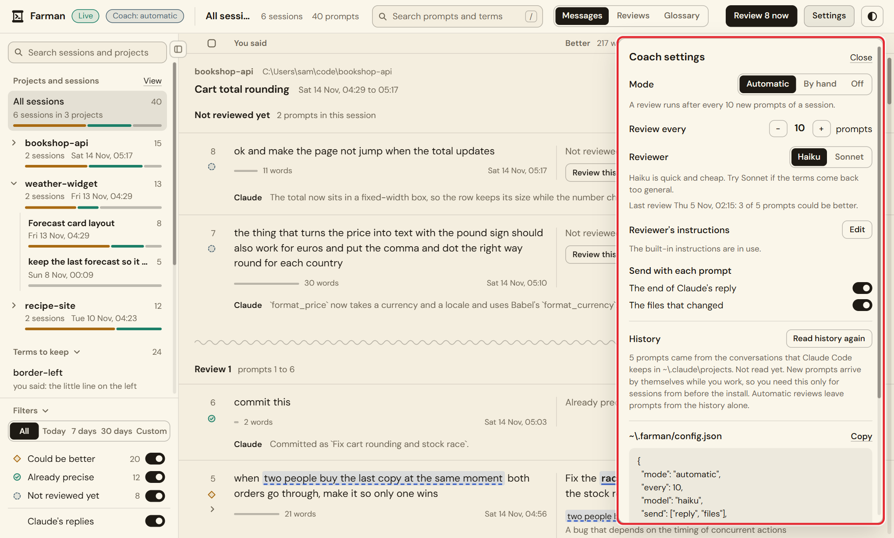

<p align="center">
  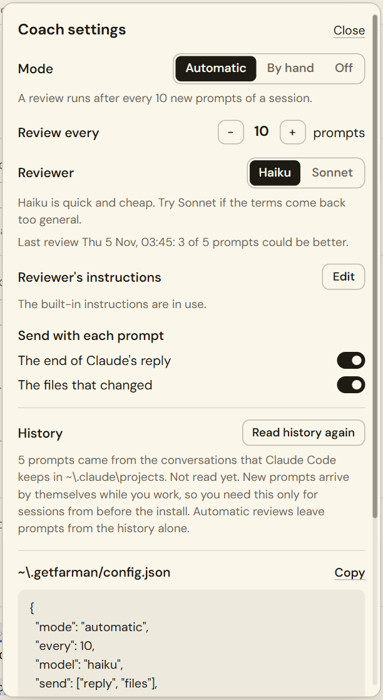
</p>

| Setting | What it does |
|---|---|
| Mode | Automatic reviews after a set number of prompts. By hand reviews only when you ask. Off also stops the log. |
| Review every | The number of new prompts that starts a review, from 3 to 50. |
| Reviewer | Haiku is quick and cheap. Try Sonnet if the terms come back too general. |
| Reviewer's instructions | The text that the reviewer is given. You can edit it and you can restore the default. |
| Send with each prompt | Whether the reviewer also gets the end of Claude's reply and the changed files. |
| History | Reads the conversations that Claude Code already keeps on your computer. |

### Dark theme

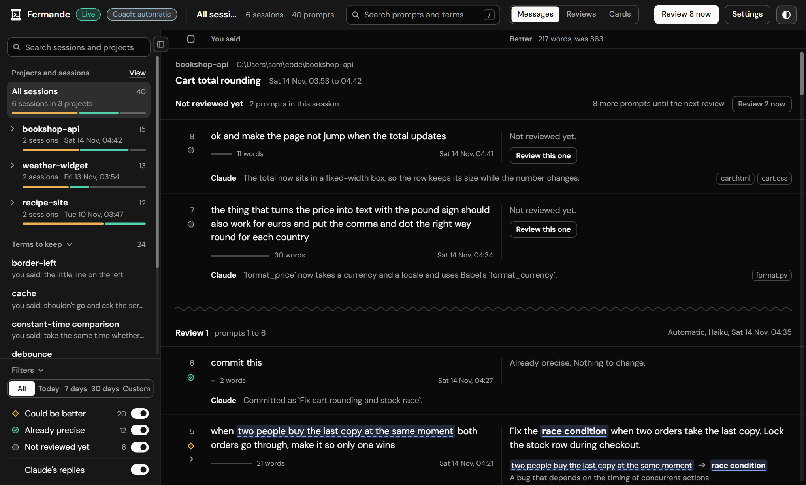

<p align="center">
  
</p>

The last button in the top bar switches between the light theme and the dark theme.

## Install

GetFarman needs Node 22.13 or newer and Claude Code. It works on Windows, macOS and Linux. It uses no packages, only what Node ships with.

```sh
npx getfarman
```

The first run sets GetFarman up and opens the page in your browser. `yarn dlx getfarman` does the same.

The setup also puts the `getfarman` command on your PATH. From then on you type `getfarman` in any new terminal, without npx.

The setup copies the app to `~/.getfarman`, adds three hooks to Claude Code's settings and adds the `/getfarman` command. It saves a backup of your settings first and leaves your other hooks alone.

Then check the install.

```sh
getfarman doctor --call
```

## Commands

Type these in a Claude Code session. The hook answers them, so they never reach Claude.

| Command | What happens |
|---|---|
| `/getfarman` | Opens the page |
| `/getfarman now` | Reviews the new prompts that wait in this session |
| `/getfarman status` | Shows the mode, the counts and the last review |
| `/getfarman on`, `hand` or `off` | Sets the mode |

In a terminal, `getfarman open` opens the page, `getfarman model sonnet` changes the reviewer and `getfarman remove` uninstalls GetFarman.

## Privacy

Your prompts and the ends of Claude's replies are stored as plain text in `~/.getfarman/getfarman.db`. They leave your computer only when a review sends them to Claude through your own `claude` login. `getfarman forget --all` empties the log.

## Licence

GetFarman is under the [MIT License](LICENSE). You may use it, change it and share it, also commercially. Keep the copyright notice and the licence text with every copy.

## Full guide

The full guide is in [docs/guide.md](docs/guide.md). It covers every command, the files that GetFarman keeps and what to do when something fails.
